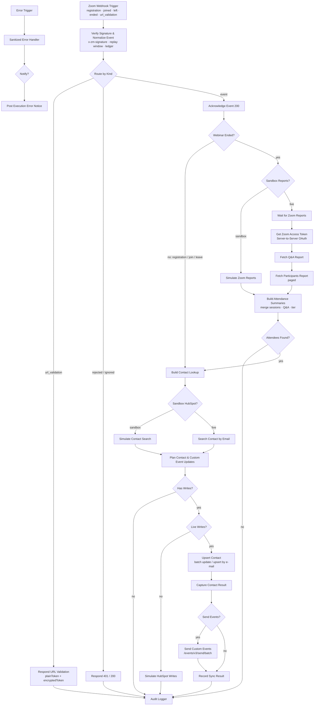

# n8n-zoom-webinar-hubspot-engagement-sync

**Zoom webinar registrations, join/leave sessions, attendance duration and Q&A participation → HubSpot contact properties and custom timeline events, verified, de-duplicated and safe to replay.**

I built this n8n workflow for event-marketing teams that run webinars in Zoom and nurture in HubSpot. The usual gap: registrations arrive through a form integration, but nobody knows who actually showed up, for how long, or who asked questions, until someone exports a CSV. This workflow listens to Zoom's webinar webhooks. It updates the matching contact as people register, join and leave. When the webinar ends, it pulls Zoom's participant and Q&A reports, merges each attendee's sessions into one accurate attendance figure, scores engagement, and posts structured custom events onto the contact timeline.

> **Safe by default.** `SANDBOX_MODE=true` and `DRY_RUN=true`. Out of the box, the workflow runs only against pinned fictional webinar deliveries. It makes no Zoom API, HubSpot or Slack calls until you turn both switches off.

Built by DH Robin · dhRobin Systems · MIT licensed.

---

## Table of Contents

1. [Why this exists](#1-why-this-exists)
2. [Architecture](#2-architecture)
3. [Repository layout](#3-repository-layout)
4. [Quick start](#4-quick-start)
5. [Zoom webhook verification](#5-zoom-webhook-verification)
6. [Zoom events & reports](#6-zoom-events--reports)
7. [Engagement tracking rules](#7-engagement-tracking-rules)
8. [Contact matching logic](#8-contact-matching-logic)
9. [HubSpot custom property mapping](#9-hubspot-custom-property-mapping)
10. [HubSpot custom events](#10-hubspot-custom-events)
11. [Environment variables](#11-environment-variables)
12. [Node configuration](#12-node-configuration)
13. [Testing stages](#13-testing-stages)
14. [Security & privacy model](#14-security--privacy-model)
15. [Troubleshooting](#15-troubleshooting)
16. [Known limitations](#16-known-limitations)
17. [Disclaimer & license](#17-disclaimer--license)

---

## 1. Why this exists

Webinar data usually reaches the CRM late and flattened:

- **"Attended: yes"** tells sales nothing. Ten minutes and fifty-five minutes are different signals.
- **Rejoins and second devices** break duration math. One person on a laptop and a phone shows up as two rows.
- **Q&A is the best intent signal in a webinar,** and it almost never reaches the contact.
- **Lists of attendees get re-imported,** so counters drift and timelines fill with duplicates.

I designed this workflow to put one accurate, de-duplicated engagement record per attendee per webinar on the contact, plus a clean event history on the timeline.

## 2. Architecture



| Required component | Nodes |
|---|---|
| 1 · Zoom Webhook Trigger | `Zoom Webhook Trigger` (raw body on, responds through Respond to Webhook nodes, 12 pinned fictional deliveries) |
| 2 · Signature Verification & Event Normalizer | `Verify Signature & Normalize Event`, the three Respond nodes, `Build Attendance Summaries` |
| 3 · HubSpot Contact & Custom Event Engine | `Build Contact Lookup`, `Search Contact by Email`, `Plan Contact & Custom Event Updates`, `Upsert Contact`, `Send Custom Events` (sandbox / dry run: the simulators) |
| 4 · Audit Logger & Sanitized Error Handler | `Audit Logger`, `Sanitized Error Handler` |

The sandbox and live paths come back together at the same nodes. Each simulator returns the shape of the real API response, so a sandbox run exercises the same summarising, matching and planning code as production.

## 3. Repository layout

```
n8n-zoom-webinar-hubspot-engagement-sync/
├── README.md        ← this file
├── workflow.json    ← import into n8n (inactive, sandbox defaults, pinned fixtures)
├── DISCLAIMER.md
└── LICENSE          ← MIT
```

All logic lives in Code nodes inside `workflow.json`. There are no community nodes and no stored n8n credentials. Every secret comes from an environment variable.

## 4. Quick start

1. In n8n, go to **Workflows → Import from File** and select `workflow.json`. The workflow imports **inactive**.
2. Open it and click **Execute Workflow**. The trigger replays 12 pinned fictional deliveries.
3. Open **Audit Logger** and compare the records with the table in [Stage 1](#stage-1--sandbox-pinned-fixtures-no-network).
4. Open **Simulate HubSpot Writes (Dry Run)** to see each contact update and the custom events that would be sent.

### n8n platform prerequisites

| Setting | Why |
|---|---|
| `N8N_BLOCK_ENV_ACCESS_IN_NODE=false` | Code nodes and expressions read configuration through `$env`. If access is blocked, the helpers fall back to the safe defaults. |
| `NODE_FUNCTION_ALLOW_BUILTIN=crypto` | Needed for HMAC and constant-time comparison. Without it, every delivery is rejected (`crypto_module_unavailable`). |
| Workflow **active** before you save the endpoint in Zoom | Zoom validates the URL immediately, and only the production webhook URL answers. |
| Concurrency of 1 for this workflow | The idempotency ledger and open-session store in static data aren't transactional. |
| Settings → Error Workflow = this workflow | Activates the sanitized error branch. |

## 5. Zoom webhook verification

### 5.1 Signatures (fails closed)

Zoom signs every delivery with your app's **Secret Token**:

```
x-zm-request-timestamp: 1794500000000
x-zm-signature: v0=<hex HMAC-SHA256(secret, "v0:{x-zm-request-timestamp}:{raw body}")>
```

The verifier rebuilds that string from the **raw** body (the trigger has *Raw Body* on), computes the HMAC, and compares in constant time (SHA-256 of both sides, then `timingSafeEqual`). Outside the sandbox, a timestamp more than `ZOOM_SIGNATURE_TOLERANCE_SECONDS` (300) away from now is rejected as a replay. Rejections (`signature_header_missing`, `timestamp_header_missing`, `signature_mismatch`, `timestamp_outside_tolerance`, `webhook_secret_not_configured`, `crypto_module_unavailable`) get **401** and nothing else runs.

### 5.2 URL validation (`endpoint.url_validation`)

When you save or re-check the endpoint, Zoom sends a `plainToken` and expects, within 3 seconds:

```json
{ "plainToken": "fxPlainToken0001abcd", "encryptedToken": "<hex HMAC-SHA256(secret, plainToken)>" }
```

That's why the trigger uses **Respond to Webhook** nodes rather than responding automatically. I added two guards here:

- **Signature first.** The validation request's signature is checked before anything is echoed back.
- **Oracle-safe tokens.** Only short, token-shaped `plainToken`s (`[A-Za-z0-9_-]{8,64}`) are signed. Without this, anyone who could reach the endpoint could ask it to HMAC a string such as `v0:{ts}:{body}` and forge a valid Zoom signature.

### 5.3 Responses

| Situation | HTTP | Body |
|---|---|---|
| URL validation | 200 | `{ plainToken, encryptedToken }` |
| Accepted event | 200 | `{ "status": "received" }`, sent **before** HubSpot processing |
| Ignored event (unsupported, duplicate, internal, no e-mail) | 200 | `{ "status": "ignored" }`, so Zoom doesn't retry |
| Bad or missing signature | 401 | `{ "message": "invalid signature" }` |

## 6. Zoom events & reports

### 6.1 Subscriptions

Create a **Server-to-Server OAuth** app (or a general app with an event subscription) in the Zoom App Marketplace. Under **Features → Event Subscriptions**, add the endpoint `https://YOUR_N8N_HOST/webhook/zoom-webinar-engagement` and these webinar events:

| Zoom event | Used for |
|---|---|
| `webinar.registration_created` | `registered` event, registration properties, optional contact creation |
| `webinar.participant_joined` | `joined` event (join timestamp) |
| `webinar.participant_left` | `left` event (leave timestamp, session minutes, leave reason) |
| `webinar.ended` | Pulls the participant and Q&A reports, then `attended` and `qa_participated` events and attendance properties |

Example registration payload (fictional):

```json
{ "event": "webinar.registration_created", "event_ts": 1794326400000,
  "payload": { "account_id": "fxAccount0001", "object": {
    "uuid": "fxW1nAr0000Uuid0001==", "id": "81234567890", "topic": "Fixture Webinar: Pipeline Hygiene Live", "type": 5,
    "start_time": "2026-11-12T15:00:00Z", "duration": 60, "timezone": "America/New_York",
    "registrant": { "id": "fxReg-alex", "first_name": "Alex", "last_name": "Rivera", "email": "Alex.Rivera@Northwind-Fixture.example",
                    "status": "approved", "create_time": "2026-11-10T14:00:00Z", "join_url": "https://zoom.example/w/fixture-personal-link" } } } }
```

Participant payloads carry `participant.{user_id, user_name, email, participant_uuid, registrant_id, join_time | leave_time, leave_reason}`. When a `left` event lacks `join_time`, the matching `joined` time is taken from a short-lived open-session store (kept in live mode only).

### 6.2 Why attendance and Q&A come from reports

Live join/leave events are good for timestamps but unreliable for totals. People rejoin, use two devices, or drop events. I also couldn't find a real-time Q&A webhook, so Q&A comes from Zoom's reports. After `webinar.ended`, the workflow:

1. **Waits** `ZOOM_REPORT_DELAY_MINUTES` (15), because Zoom finalises reports a little after the webinar ends.
2. **Gets a token** from `POST https://zoom.us/oauth/token?grant_type=account_credentials&account_id=…` (Basic `ZOOM_CLIENT_ID:ZOOM_CLIENT_SECRET`).
3. **Reads Q&A** from `GET /v2/report/webinars/{uuid}/qa`, which gives `questions[].{name, email, question_details[].{question, answer, question_status}}`.
4. **Reads participants** from `GET /v2/report/webinars/{uuid}/participants?page_size=300`, paged by `next_page_token` up to 20 pages. That gives `participants[].{user_email, join_time, leave_time, duration (seconds), registrant_id}`.

Report scopes: `report:read:admin`, or the granular `report:read:list_webinar_participants:admin` and `report:read:webinar_qa:admin`. Reports need a paid plan with the Webinar add-on. UUIDs that start with `/` or contain `//` are double-encoded, as Zoom requires.

## 7. Engagement tracking rules

Computed per attendee in `Build Attendance Summaries`:

| Metric | Rule |
|---|---|
| Attended minutes | All of the attendee's report rows, with **overlapping intervals merged** (a laptop and a phone at the same time count once), rounded to minutes |
| Sessions | Number of report rows (joins) |
| First join / last leave | Earliest `join_time` / latest `leave_time` |
| Webinar minutes | Actual `end_time − start_time`, else scheduled `duration`, else the report span |
| Attendance % | attended ÷ webinar minutes, capped at 100 |
| Questions asked / answered | Q&A report entries for the attendee's e-mail (answered = has an answer or a non-open status) |
| Engagement tier | `brief` under `MIN_ATTENDED_MINUTES` (5) · `hot` ≥ `HOT_ATTENDANCE_PCT` (75 %), or ≥ 50 % **and** asked a question · `warm` ≥ `WARM_ATTENDANCE_PCT` (40 %) or asked a question · `cold` otherwise |

Excluded before anything reaches HubSpot:
- Rows and registrations from `INTERNAL_EMAIL_DOMAINS` (hosts, panelists, your team).
- Participants without an e-mail (guests who weren't required to sign in).
- Webinars outside `WEBINAR_ID_ALLOWLIST`, when set.

Fixture example, Alex: sessions 15:02–15:40, 15:10–15:20 (second device) and 15:45–16:00 give 38 + 15 = **53 minutes**, not 63. That's 88 % of 60 minutes, with 2 questions, so **hot**.

## 8. Contact matching logic

1. **E-mail normalisation:** trimmed, lower-cased and syntax-checked (`Alex.Rivera@Northwind-Fixture.example` → `alex.rivera@northwind-fixture.example`).
2. **Search:** `POST /crm/v3/objects/contacts/search` with `email EQ` OR `hs_additional_emails CONTAINS_TOKEN`. An exact primary e-mail wins; otherwise the additional-e-mail match is used.
3. **No match:**
   - `registered` + `CREATE_CONTACT_ON_REGISTRATION=true` (default): the contact is created through `batch/upsert` with `idProperty: "email"`, filling e-mail, first and last name, company and job title.
   - `attended` + `CREATE_CONTACT_FOR_ATTENDEES=true` (default **false**): same.
   - Otherwise the item is logged with a hold and nothing is written.
4. **Existing values are never overwritten:** name, company and job title are filled only where the contact has none.
5. **The custom events use the contact's `objectId`,** so they always land on the record that was just updated.

## 9. HubSpot custom property mapping

Create these contact properties in a group named "Zoom webinars". The `zoom_` prefix is configurable with `ZOOM_PROPERTY_PREFIX`.

| Internal name | Type | Written on |
|---|---|---|
| `zoom_last_engagement_at` | date picker | every write |
| `zoom_last_webinar_registered_at` | date picker | registration |
| `zoom_last_webinar_registered_topic` | single-line text | registration |
| `zoom_last_webinar_registered_uuid` | single-line text | registration (guards the count) |
| `zoom_webinars_registered_count` | number | registration, +1 once per webinar |
| `zoom_last_webinar_joined_at` / `zoom_last_webinar_left_at` | date picker | join / leave |
| `zoom_last_webinar_attended_at` | date picker | attendance summary |
| `zoom_last_webinar_topic` | single-line text | attendance summary |
| `zoom_last_webinar_uuid` | single-line text | attendance summary (guards the totals) |
| `zoom_last_webinar_minutes` | number | attendance summary |
| `zoom_last_webinar_attendance_pct` | number | attendance summary |
| `zoom_last_webinar_questions` | number | attendance summary |
| `zoom_webinar_engagement_tier` | dropdown: `hot`, `warm`, `cold`, `brief` | attendance summary |
| `zoom_webinars_attended_count` | number | attendance summary, +1 once per webinar |
| `zoom_webinar_minutes_total` | number | attendance summary, + minutes once per webinar |
| `zoom_webinar_questions_total` | number | attendance summary, + questions once per webinar |

**Replay-safe totals.** Counters are incremented only when the contact's stored `…_uuid` differs from the webinar UUID. A replayed `webinar.ended` refreshes the "last webinar" fields but never double-counts.

Private app scopes: `crm.objects.contacts.read`, `crm.objects.contacts.write`, `analytics.behavioral_events.send`.

## 10. HubSpot custom events

### 10.1 Definitions

Custom events require an existing definition. Their fully qualified names look like `pe{portalId}_{name}`. Create five definitions associated with **contacts**, either in HubSpot (Data Management → Custom events) or with `POST /events/v3/event-definitions`, for example:

```json
{ "label": "Zoom webinar attended", "name": "zoom_webinar_attended", "primaryObject": "CONTACT",
  "description": "Attendance summary after a Zoom webinar ends (dhRobin Systems sync).",
  "propertyDefinitions": [
    { "name": "webinar_id", "label": "Webinar ID", "type": "string" },
    { "name": "webinar_uuid", "label": "Webinar UUID", "type": "string" },
    { "name": "webinar_topic", "label": "Webinar topic", "type": "string" },
    { "name": "webinar_start_time", "label": "Webinar start", "type": "datetime" },
    { "name": "engagement_type", "label": "Engagement type", "type": "string" },
    { "name": "registrant_id", "label": "Registrant ID", "type": "string" },
    { "name": "first_join_time", "label": "First join", "type": "datetime" },
    { "name": "last_leave_time", "label": "Last leave", "type": "datetime" },
    { "name": "attended_minutes", "label": "Attended minutes", "type": "number" },
    { "name": "attendance_pct", "label": "Attendance %", "type": "number" },
    { "name": "sessions", "label": "Sessions", "type": "number" },
    { "name": "questions_asked", "label": "Questions asked", "type": "number" },
    { "name": "engagement_tier", "label": "Engagement tier", "type": "enumeration",
      "options": [ { "label": "Hot", "value": "hot" }, { "label": "Warm", "value": "warm" }, { "label": "Cold", "value": "cold" }, { "label": "Brief", "value": "brief" } ] }
  ] }
```

| Event | Internal name (default) | Extra properties |
|---|---|---|
| Registered | `pe{portal}_zoom_webinar_registered` | `registration_status` |
| Joined | `pe{portal}_zoom_webinar_joined` | `join_time` |
| Left | `pe{portal}_zoom_webinar_left` | `join_time`, `leave_time`, `session_minutes`, `leave_reason` |
| Attended | `pe{portal}_zoom_webinar_attended` | as above |
| Q&A participated | `pe{portal}_zoom_webinar_qa_participated` | `questions_asked`, `questions_answered`, (`first_question` only if `INCLUDE_QUESTION_TEXT=true`) |

Every event also carries `webinar_id`, `webinar_uuid`, `webinar_topic`, `webinar_start_time`, `engagement_type` and `registrant_id`. The names are built from `HUBSPOT_PORTAL_ID`, or set exactly with `HUBSPOT_EVENT_REGISTERED`, `HUBSPOT_EVENT_JOINED`, `HUBSPOT_EVENT_LEFT`, `HUBSPOT_EVENT_ATTENDED` and `HUBSPOT_EVENT_QA_PARTICIPATED`. If neither is set, events are held with a clear reason, and contact properties are still written.

### 10.2 Send

`POST /events/v3/send/batch`:

```json
{ "inputs": [
  { "eventName": "pe1234567_zoom_webinar_attended", "objectId": "CONTACT_ID", "occurredAt": "2026-11-12T16:00:00.000Z",
    "uuid": "a0ee6e8c-9478-424b-af21-b52c2b583a33",
    "properties": { "webinar_id": "81234567890", "webinar_uuid": "fxW1nAr0000Uuid0001==", "webinar_topic": "Fixture Webinar: Pipeline Hygiene Live",
                    "attended_minutes": "53", "attendance_pct": "88", "sessions": "3", "questions_asked": "2", "engagement_tier": "hot" } } ] }
```

- `occurredAt` is the real moment (registration time, join/leave time, last leave), so the timeline reads in order.
- `uuid` is derived deterministically from the engagement key, so the same engagement always carries the same ID.
- The send isn't auto-retried. The contact upsert, which is idempotent, is.
- Set `SEND_JOIN_LEAVE_EVENTS=false` for a quieter timeline (only registered, attended and Q&A).

## 11. Environment variables

Copy this block into your n8n environment and replace every placeholder.

```bash
# ── Safety switches (both must be "false" before anything is written) ──
SANDBOX_MODE=true
DRY_RUN=true

# ── Zoom webhook ──
ZOOM_WEBHOOK_SECRET=YOUR_ZOOM_WEBHOOK_SECRET_TOKEN
ZOOM_SIGNATURE_TOLERANCE_SECONDS=300
PROCESS_EVENT_TYPES=webinar.registration_created,webinar.participant_joined,webinar.participant_left,webinar.ended
# Optional: only these webinar IDs (comma-separated)
WEBINAR_ID_ALLOWLIST=
INTERNAL_EMAIL_DOMAINS=YOUR_COMPANY_DOMAIN.example
EVENT_LEDGER_DAYS=30

# ── Zoom reports (Server-to-Server OAuth) ──
ZOOM_ACCOUNT_ID=YOUR_ZOOM_ACCOUNT_ID
ZOOM_CLIENT_ID=YOUR_ZOOM_CLIENT_ID
ZOOM_CLIENT_SECRET=YOUR_ZOOM_CLIENT_SECRET
ZOOM_API_BASE_URL=https://api.zoom.us/v2
ZOOM_REPORT_DELAY_MINUTES=15

# ── Engagement rules ──
MIN_ATTENDED_MINUTES=5
HOT_ATTENDANCE_PCT=75
WARM_ATTENDANCE_PCT=40
INCLUDE_QUESTION_TEXT=false
SEND_JOIN_LEAVE_EVENTS=true

# ── HubSpot ──
HUBSPOT_ACCESS_TOKEN=YOUR_HUBSPOT_PRIVATE_APP_TOKEN
HUBSPOT_PORTAL_ID=YOUR_HUBSPOT_PORTAL_ID
HUBSPOT_API_BASE_URL=https://api.hubapi.com
ZOOM_PROPERTY_PREFIX=zoom_
CREATE_CONTACT_ON_REGISTRATION=true
CREATE_CONTACT_FOR_ATTENDEES=false
# Optional exact event names (default pe{HUBSPOT_PORTAL_ID}_zoom_webinar_<type>)
HUBSPOT_EVENT_REGISTERED=
HUBSPOT_EVENT_JOINED=
HUBSPOT_EVENT_LEFT=
HUBSPOT_EVENT_ATTENDED=
HUBSPOT_EVENT_QA_PARTICIPATED=

# ── Error notices (optional) ──
SLACK_WEBHOOK_URL=YOUR_SLACK_WEBHOOK_URL
SLACK_NOTIFY_ON_MONITOR_ERROR=true

# ── Audit ──
AUDIT_LOG_TO_STDOUT=true
AUDIT_RING_BUFFER_SIZE=500

# ── n8n platform ──
N8N_BLOCK_ENV_ACCESS_IN_NODE=false
NODE_FUNCTION_ALLOW_BUILTIN=crypto
```

Flags accept only `true/1/yes/on` or `false/0/no/off`. Anything else keeps the safe default. Values starting with `YOUR_` are treated as unset where it matters (portal ID, event names). Keep comments on their own lines, because Docker env files don't support inline comments.

## 12. Node configuration

| Node | Type | Key settings |
|---|---|---|
| Zoom Webhook Trigger | Webhook v2 | POST `zoom-webinar-engagement` · **Respond: Using 'Respond to Webhook' node** · **Raw Body on** |
| Verify Signature & Normalize Event | Code v2, all items | signature, URL validation, normalisation, ledger, open sessions |
| Route by Kind | Switch v3.2 | `url_validation` / `event` / fallback |
| Respond URL Validation / Acknowledge Event / Respond Rejected or Ignored | Respond to Webhook v1.1 | JSON body `$json.response`; code 200, 200 and `$json.httpStatus` |
| Wait for Zoom Reports | Wait v1.1 | time interval `ZOOM_REPORT_DELAY_MINUTES` (live only) |
| Get Zoom Access Token | HTTP Request v4.2 | POST · `Authorization: Basic` built with `.base64Encode()` from `ZOOM_CLIENT_ID:ZOOM_CLIENT_SECRET` |
| Fetch Q&A Report / Fetch Participants Report | HTTP Request v4.2 | Bearer token from the previous node · full response · never error · participants paginated by `next_page_token` |
| Build Attendance Summaries | Code v2, all items | merge sessions, Q&A, tier, ledger skip |
| Search Contact by Email | HTTP Request v4.2 | `Authorization: Bearer {{$env.HUBSPOT_ACCESS_TOKEN}}` · 3 tries |
| Plan Contact & Custom Event Updates | Code v2, each item | sections 8–10 |
| Upsert Contact | HTTP Request v4.2 | `batch/update` or `batch/upsert` (`idProperty: email`) · idempotent · 3 tries |
| Send Custom Events | HTTP Request v4.2 | `/events/v3/send/batch` · **no auto-retry** |
| Record Sync Result | Code v2, each item | ledger write when the contact and every event succeeded |
| Audit Logger | Code v2, each item | masked e-mails · stdout · `zoomEngagementAudit` ring buffer (not in sandbox) |
| Error Trigger → Sanitized Error Handler | Error Trigger v1 + Code v2 | redacted summary, optional Slack notice |

## 13. Testing stages

### Stage 1 · Sandbox (pinned fixtures, no network)

`SANDBOX_MODE=true`, `DRY_RUN=true`. Execute the workflow and compare the Audit Logger records:

| Delivery | Expected |
|---|---|
| `endpoint.url_validation` | `{ plainToken, encryptedToken }` |
| registration · Alex (mixed-case e-mail) | existing contact · registered count 2 → 3 · `registered` event |
| registration · Priya | new contact via upsert (name, company, job title) · `join_url` never stored |
| registration · Morgan | matched on `hs_additional_emails` |
| registration · events-team (internal domain) | ignored · `internal_email_domain` |
| joined · Alex | `joined` event |
| left · Alex | `left` event · 38-minute session |
| joined · iPad guest (no e-mail) | ignored · `participant_without_email` |
| registration · Alex again | ignored · `duplicate_event` |
| `meeting.started` | ignored · `event_type_not_processed` |
| tampered registration | rejected · 401 `signature_mismatch` |
| `webinar.ended` | Alex **hot** (53 min, 88 %, 2 Qs, overlap merged) · Jordan **hot** but totals unchanged (already counted) · Morgan **warm** (42 %) · Priya cold · Taylor brief |

Priya and Taylor show a hold in the sandbox. Taylor has no HubSpot contact and attendee creation is off. Priya's contact was only *simulated* at registration, so it doesn't exist in the fixtures. In live mode the registration upsert creates her first, and her attendance then lands on that contact. The host row and the guest without an e-mail are excluded. All names, e-mails (`*.example`), IDs, tokens and secrets are fictional.

### Stage 2 · Shadow (real reports and lookups, writes simulated)

`SANDBOX_MODE=false`, `DRY_RUN=true`:

1. Create the Zoom app, add the event subscription, **activate** the workflow, and let Zoom validate the URL.
2. Run a short test webinar with two registrants. One of them should join twice and ask a question.
3. After it ends and the wait elapses, check `Build Attendance Summaries` and `Simulate HubSpot Writes (Dry Run)`.

### Stage 3 · Live in a HubSpot test portal

Create the properties (section 9) and event definitions (section 10), set `DRY_RUN=false`, and repeat. Confirm:
- the contact properties are set and the timeline events appear;
- re-sending `webinar.ended` neither double-counts nor duplicates events (ledger + UUID guard);
- an old timestamp is rejected.

Make the workflow its own **Error Workflow** and force a failure (an invalid token) to see the sanitized notice.

### Stage 4 · Production

Start with one webinar series (`WEBINAR_ID_ALLOWLIST`) and review a few contacts with your marketing ops team before widening.

## 14. Security & privacy model

- **No secrets in the workflow.** The Zoom secret token, client ID and secret, and the HubSpot token come from `$env`. The JSON contains only placeholders and a clearly fictional sandbox secret, which is used only while `SANDBOX_MODE=true`.
- **Fails closed.** Every delivery, including URL validation, needs a valid signature. Stale timestamps are rejected. The validation endpoint can't be abused as a signing oracle.
- **Minimal personal data.**
  - Zoom personal join links (`join_url`) are never copied.
  - Question text isn't sent to HubSpot unless `INCLUDE_QUESTION_TEXT=true`.
  - Names, company and job title are written only to empty fields.
  - Internal and anonymous participants are excluded.
- **Redacted logs.**
  - The audit record masks e-mails (`a***@domain`) and logs IDs, types and metrics only.
  - Keys matching `authorization|token|secret|password|api key|cookie|signature|webhook url` are replaced.
  - Known secret values, Bearer tokens, JWTs (Zoom access tokens), HubSpot `pat-` tokens and Slack webhook URLs are scrubbed from every string.
- **Sanitized errors.** The error branch drops stack traces, request options and bodies.
- **Restrict n8n execution data.** Executions contain full payloads and the short-lived Zoom access token returned by the token node. Limit who can open executions, and set a short retention period (or `EXECUTIONS_DATA_SAVE_ON_SUCCESS=none` once tested).
- **Consent.** Registration alone isn't marketing consent. This workflow doesn't change subscription or consent properties.

## 15. Troubleshooting

| Symptom | Likely cause | Fix |
|---|---|---|
| Zoom says "URL validation failed" | Workflow inactive, test URL used, or the response wasn't sent in 3 s | Activate it, use the production URL, and keep Respond URL Validation directly after the router |
| Every delivery `signature_mismatch` | Wrong secret token, or a proxy re-serialises JSON | Copy the token from the app's Event Subscriptions page; keep **Raw Body** on |
| `timestamp_outside_tolerance` | Server clock drift | Sync the clock (NTP) |
| `crypto_module_unavailable` | Built-in modules blocked | `NODE_FUNCTION_ALLOW_BUILTIN=crypto` |
| `report_unavailable` | Missing report scopes or no webinar plan, or the report isn't ready | Add the scopes; raise `ZOOM_REPORT_DELAY_MINUTES` |
| Durations of 0 | Report fetched too early | Raise the delay |
| Attendees without e-mail | Guests weren't required to sign in or register | Require registration for the webinar |
| `custom event name … not configured` | No portal ID or event names | Set `HUBSPOT_PORTAL_ID` or the `HUBSPOT_EVENT_*` names |
| Event send 400 "not found" | Definition missing, or the property isn't defined on it | Create the definition and its properties (section 10) |
| Contact write 400 "Property does not exist" | Properties not created, or a different prefix | Create them (section 9) or set `ZOOM_PROPERTY_PREFIX` |
| Numbers jump twice | Concurrency > 1 | Concurrency 1 for this workflow |

## 16. Known limitations

- **No real-time Q&A webhook.** Q&A arrives with the post-webinar report only.
- **No no-show events.** Registrants who never joined aren't flagged. Pulling `GET /webinars/{id}/registrants` after the webinar is a natural extension, but it isn't included.
- **Report retries:** if the reports aren't ready after the wait, the summary logs `report_unavailable`. Re-send the `webinar.ended` payload or trigger a manual run later.
- **Recurring webinars:** each occurrence has its own UUID, and totals count each occurrence separately.
- **`zoom_last_engagement_at`** reflects the last processed event, which can arrive out of order.
- **Static data isn't transactional.** Keep concurrency at 1.

---

## 17. Disclaimer & license

### ⚠️ Disclaimer & Liability Limitation

Use at your own risk. The code, workflows, and scripts in this repository (`n8n-zoom-webinar-hubspot-engagement-sync`) are provided for educational and architectural demonstration purposes.

* **No Liability:** The author and dhRobin Systems accept no responsibility or liability for any direct, indirect, incidental, or consequential damages that result from using, misusing, or deploying these scripts. That includes missed, duplicated or misattributed webinar engagement, contacts created or updated in error, and any record created or changed in a connected system.
* **No Warranty:** All software, n8n JSON blueprints and JavaScript modules are provided "AS IS", without warranty of any kind, express or implied. This includes, but is not limited to, warranties of merchantability, fitness for a particular purpose, and non-infringement.
* **Production Testing Required:** Always test thoroughly in an isolated staging environment, such as a HubSpot developer test account or sandbox, a test Zoom app and a test webinar, with `SANDBOX_MODE=true` and `DRY_RUN=true` enabled, before you connect live Zoom or HubSpot credentials. Treat every engagement score as a signal that a person must review before acting on it.
* **Third-Party APIs & Compliance:** You alone are responsible for complying with the terms of service, rate limits, data privacy regulations (GDPR/CCPA), recording and consent rules, and security policies of Zoom, HubSpot and any connected services. That includes telling registrants and attendees how their registration, attendance and Q&A data is used, confirming a lawful basis for storing it in your CRM, keeping question text and personal data out of places it doesn't belong, and reviewing every automatically created or updated record.

The full disclaimer is also available in [DISCLAIMER.md](https://github.com/dhrobinsystems/n8n-zoom-webinar-hubspot-engagement-sync/blob/main/DISCLAIMER.md).

### License

Released under the MIT License. Copyright (c) 2026 DH Robin (dhRobin Systems). See [LICENSE](https://github.com/dhrobinsystems/n8n-zoom-webinar-hubspot-engagement-sync/blob/main/LICENSE).

---

Full text: DISCLAIMER.md · Licensed under the MIT License. License: MIT © 2026 DH Robin (dhRobin Systems) · Provided as-is, see the disclaimer.
